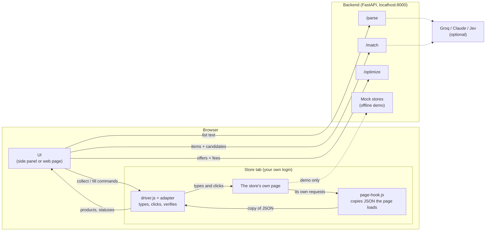
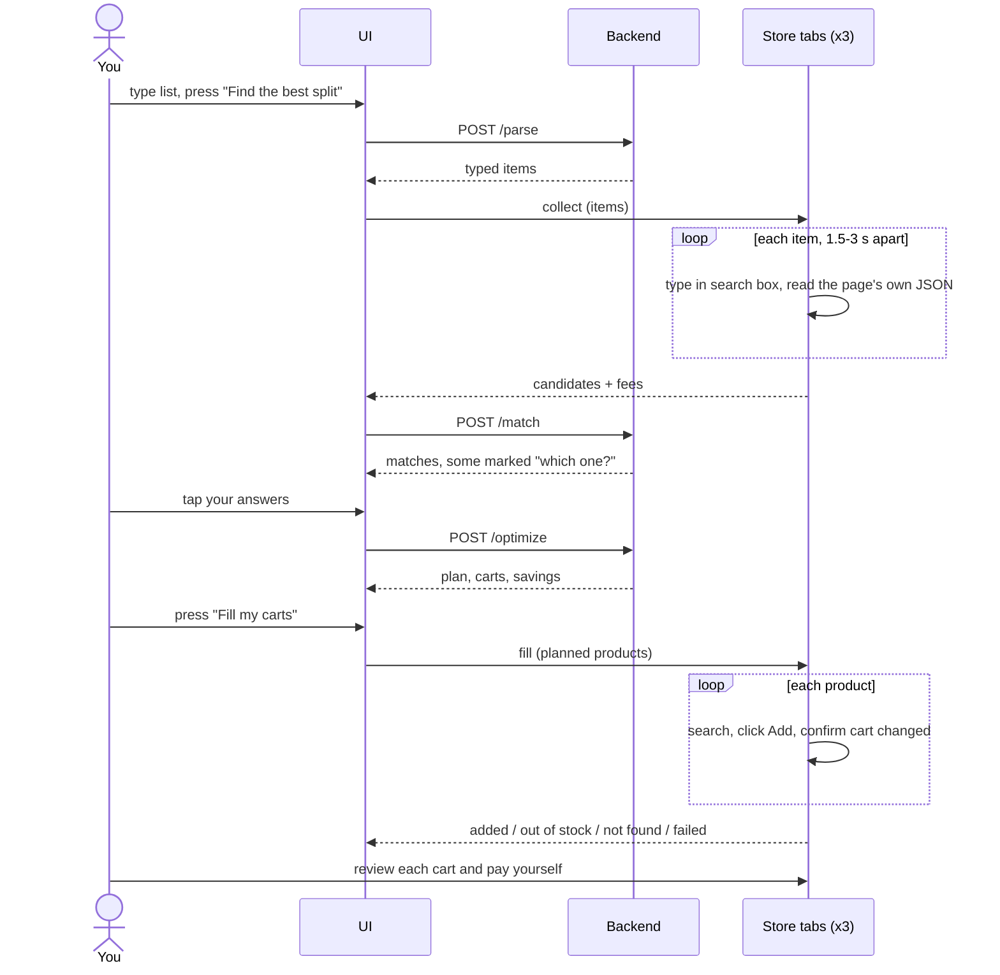
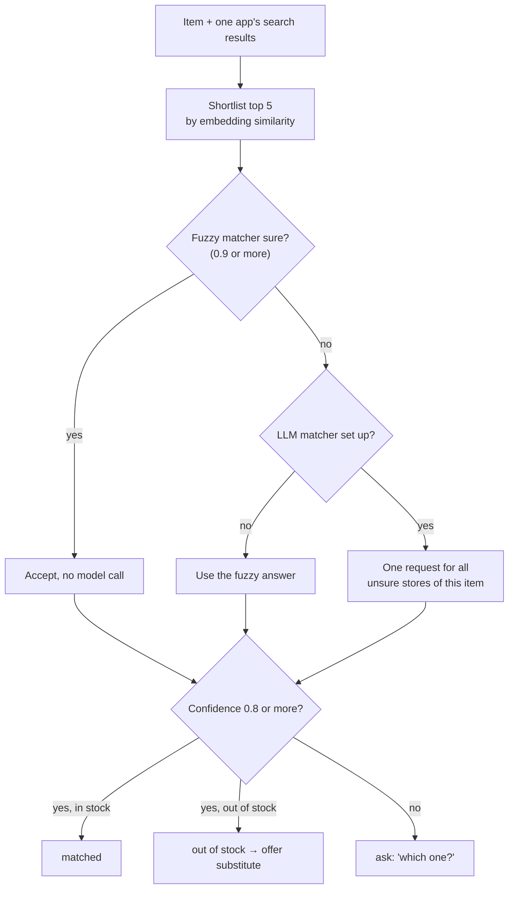
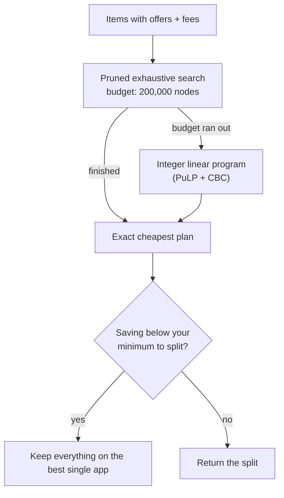

# CartPilot

> **A fun side project.** Built for learning and for the joy of it. It is not a
> product, not affiliated with Zepto, Blinkit or Swiggy Instamart, and comes with
> no guarantees. The offline demo is solid; the live-store part is unfinished.

One grocery list in, the cheapest split across quick-commerce apps out.

CartPilot finds each item's price on each app, works out the cheapest way to split
the list (delivery fees and free-delivery thresholds included), shows what you save,
and fills each cart with visible clicks. **You always review and pay yourself.**

```
"1L amul milk, eggs, 2 maggi"  →  prices on 3 apps  →  cheapest split  →  carts filled  →  you pay
```

## Try it in two minutes

```bash
make setup     # Python 3.11 venv, Node deps, Chromium for tests
make run       # http://localhost:8000
```

Open http://localhost:8000, click a sample list, press **Find the best split**.
The right-hand pane shows three mock stores; watch CartPilot type, search and click
Add in them. No keys, no internet, no accounts needed.

Without `make`:

```bash
cd backend
python3.11 -m venv .venv && .venv/bin/pip install -r requirements-dev.txt
.venv/bin/uvicorn cartpilot.main:app --port 8000
```

## What it does

| Step | What happens | Uses an LLM? |
|---|---|---|
| **Parse** | Free text becomes typed items (name, brand, size, quantity) | Optional (Groq or Claude); rule parser otherwise |
| **Collect** | Each item is typed into each store's own search box; the results the page loads are read | No |
| **Match** | The right product is picked per app; unsure cases become a "which one?" card | Optional (Groq or Jev); fuzzy matcher otherwise |
| **Optimise** | Cheapest split across apps, fees included | Never. Exact maths only |
| **Fill** | The real Add buttons are clicked, the cart is checked, a report is shown | No |

## Architecture

Three parts: a backend that thinks, an extension that acts inside your browser,
and one UI shared by the side panel and the web page.



Solid lines always happen. Dotted lines are optional: with no keys there is no LLM,
and the mock stores stand in for the real sites.

### One run, start to finish



### How a product is picked



### How the cheapest split is found



No LLM is involved in this step. Full detail is in
[docs/ARCHITECTURE.md](docs/ARCHITECTURE.md) and
[docs/MATCHING-AND-OPTIMISER.md](docs/MATCHING-AND-OPTIMISER.md).

## Status

| Part | State |
|---|---|
| Backend API (`/parse`, `/match`, `/optimize`) | Working, 202 tests |
| Web demo with mock stores | Working, tested in a real browser |
| Chrome extension on mock stores | Working, tested loaded into Chromium |
| Groq for parsing and matching | Working, checked with real calls |
| Zepto / Blinkit / Instamart live adapters | **Scaffolds only. Never run on the real sites** |
| Claude and Jev paths | Written, tested with fakes only |
| Docker image | Written, never built |

## Documentation

| Doc | What is in it |
|---|---|
| [docs/ARCHITECTURE.md](docs/ARCHITECTURE.md) | Components, data flow, diagrams, design decisions |
| [docs/API.md](docs/API.md) | Every endpoint with request and response examples |
| [docs/EXTENSION.md](docs/EXTENSION.md) | How the extension works, adapters, the setup recorder, going live |
| [docs/MATCHING-AND-OPTIMISER.md](docs/MATCHING-AND-OPTIMISER.md) | How products are picked and how the split is solved |
| [docs/DEVELOPMENT.md](docs/DEVELOPMENT.md) | Setup, configuration, tests, project layout, troubleshooting |
| [docs/RULES.md](docs/RULES.md) | The safety rules and exactly where each is enforced |

## Project layout

```
backend/     FastAPI app: parse, match, optimise, plus the mock stores
extension/   Chrome extension (Manifest V3) and the shared UI in extension/panel
e2e/         Playwright browser tests (web demo and the real extension)
docs/        The documents listed above
scripts/     Icon generator
```

## Use it as a Chrome extension

1. Keep the backend running (`make run`).
2. Chrome → `chrome://extensions` → Developer mode on → **Load unpacked** → pick `extension/`.
3. Click the CartPilot icon to open the side panel.
4. Under **Stores**, press **Open** for each store, then run a list.

The side panel and the web page are the same UI. See [docs/EXTENSION.md](docs/EXTENSION.md).

## Optional keys

Copy `backend/.env.example` to `backend/.env`. Nothing is required.

| Key | Effect |
|---|---|
| `GROQ_API_KEY` | Groq reads the list and picks products (`openai/gpt-oss-120b` by default) |
| `ANTHROPIC_API_KEY` | Claude Haiku reads the list when no Groq key is set |
| `JEV_API_KEY` | The Jev model picks products instead of Groq |

Any model failure falls back to the offline path for that call.

## Tests

```bash
make test   # 202 backend tests
make e2e    # 26 browser tests
```

## The rules it plays by

- Reads only what the store page already loads in your own logged-in tab.
- One item at a time, 1.5 to 3 seconds apart on live stores.
- Stops if the store shows a CAPTCHA or bot check. No bypass.
- Cart filling is visible clicks on the real Add button.
- Never touches checkout or payment. No stored passwords.

Details and code references are in [docs/RULES.md](docs/RULES.md).

## Honest limits

- **Live stores are untested.** The adapters for the real apps are best guesses until calibrated
  with the setup recorder ([docs/EXTENSION.md](docs/EXTENSION.md#going-live)).
- **Live fees are placeholders.** Correct them in the panel before trusting a live plan.
- **Mock prices and fees are invented**, and tilted so a big basket has something to gain from
  splitting. Small baskets often come out cheapest on one app, which is realistic.
- **Terms of service.** Automating a store's website may be against its terms. Keep live use personal.
- **No licence file yet.** Add one before sharing the code publicly.

More in [docs/DEVELOPMENT.md](docs/DEVELOPMENT.md#known-gaps).
