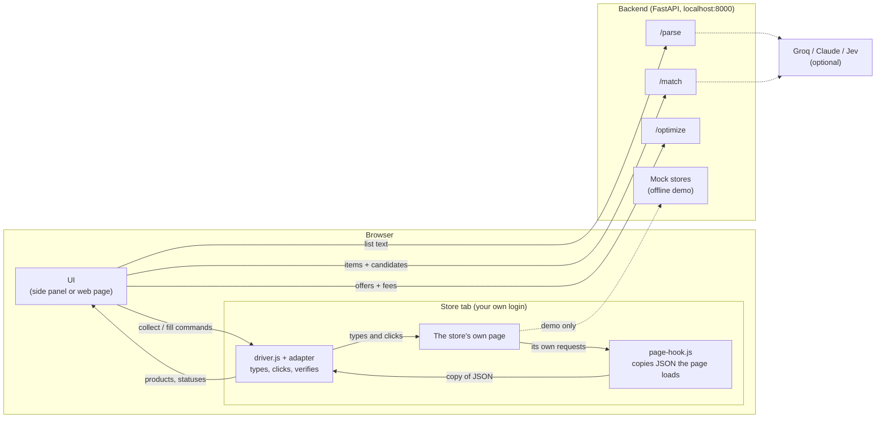
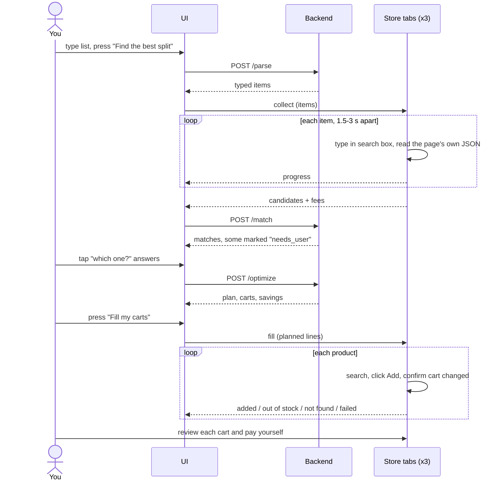
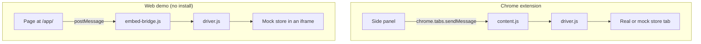

# Architecture

CartPilot is a fun side project with three parts: a backend that thinks, an
extension that acts inside the browser, and a UI shared by both a web page and the
extension's side panel.

## The big picture



Solid lines always happen. Dotted lines are optional: with no keys there is no LLM,
and the mock stores stand in for the real sites.

## Components

| Component | Where | Job |
|---|---|---|
| **UI** | `extension/panel/` | One vanilla-JS app. Runs as the extension side panel and as a web page at `/app/` |
| **Transport** | `extension/panel/transport.js` | How the UI reaches store pages: `ExtensionTransport` (real tabs) or `EmbedTransport` (iframes in the web demo) |
| **Page hook** | `extension/src/page-hook.js` | Runs in the page's own JavaScript world. Wraps `fetch` and XHR, posts a copy of JSON responses. Makes no requests itself |
| **Adapters** | `extension/src/adapters.js` | One per store: which pages it handles, selectors, which responses are search/cart, and `normalize()` |
| **Driver** | `extension/src/driver.js` | The engine: search, collect, fill, verify. Owns pacing and the stop-on-bot-check rule |
| **Content script** | `extension/src/content.js` | Bridges extension messages to the driver in a tab |
| **Embed bridge** | `extension/src/embed-bridge.js` | Same bridge over `postMessage`, for the web demo's iframes |
| **Recorder** | `extension/src/recorder.js` | One-time capture of a live store's shape, scrubbed of personal data |
| **Service worker** | `extension/background.js` | Opens the side panel; keeps steady timers for background tabs |
| **Parser** | `backend/cartpilot/parsing.py` | `parse_list()` with swappable providers: rules, Groq, Anthropic |
| **Matcher** | `backend/cartpilot/matching.py` | Shortlist, chooser, confidence gate, cross-app variants, substitutes |
| **Optimiser** | `backend/cartpilot/optimizer.py` | Exact cheapest split. Pruned search, ILP fallback |
| **Mock stores** | `backend/cartpilot/mockstores.py` | Three fake storefronts with different JSON shapes and a real cart |

## One run, step by step



## Two ways to run the same code

The driver does not know how it is being talked to. That is the trick that makes
the offline demo honest: it exercises the same code the extension uses.



| | Extension | Web demo |
|---|---|---|
| Stores | Real tabs (mock or live) | Mock stores in same-origin iframes |
| Messages | `chrome.runtime` | `window.postMessage` |
| Price collection | All stores in parallel, in background tabs | All stores in parallel |
| Cart filling | One store at a time, its tab brought to the front | In parallel |
| Live stores | Yes (once calibrated) | No |

## Why the page hook lives in the page's world

A content script runs in an isolated JavaScript world: it sees the DOM but not the
page's `fetch`. To read what the page loads for itself, a tiny script must run in
the page's own world (`"world": "MAIN"` in the manifest). It does one thing: copy
JSON responses out with `window.postMessage`. The driver, in the isolated world,
listens for those copies and ignores everything that is not a search, cart or
config response for its adapter.

## The common product shape

Every adapter's `normalize()` turns its store's JSON into this, so nothing
downstream knows or cares which store it came from:

```json
{
  "id": "z-amul-taaza-1l",
  "app": "zepto",
  "name": "Amul Taaza Toned Milk",
  "brand": "Amul",
  "size_text": "1 L",
  "price": 68,
  "mrp": 72,
  "in_stock": true,
  "image": "🥛",
  "rank": 0
}
```

## Design decisions

| Decision | Why |
|---|---|
| **The optimiser never uses an LLM** | Money maths must be exact and repeatable. It is tested against an independent brute force |
| **LLMs are optional everywhere** | The demo must run offline; a bad key must never break a run. Every model call has a deterministic fallback |
| **Ask the user when unsure** | The worst failure is silently adding the wrong product. Below 0.8 confidence the UI asks |
| **Read JSON, click DOM** | JSON gives clean prices and stock; clicking the real button keeps cart filling visible and avoids calling private cart APIs |
| **One adapter file per store** | Sites change. When one does, one file changes |
| **Vanilla JS, no build step** | Extension pages cannot load remote scripts, and no bundler means the folder loads as-is |
| **Money in integer paise** | No floating-point drift in totals |
| **Pacing lives in the driver** | The UI cannot ask a live store to go faster; the rule is enforced where the clicks happen |

## What is not here

No database, no accounts, no server-side sessions (apart from the mock stores'
in-memory carts). Remembered choices and settings live in the browser's
`localStorage`. The backend is stateless and can be restarted at any time.
