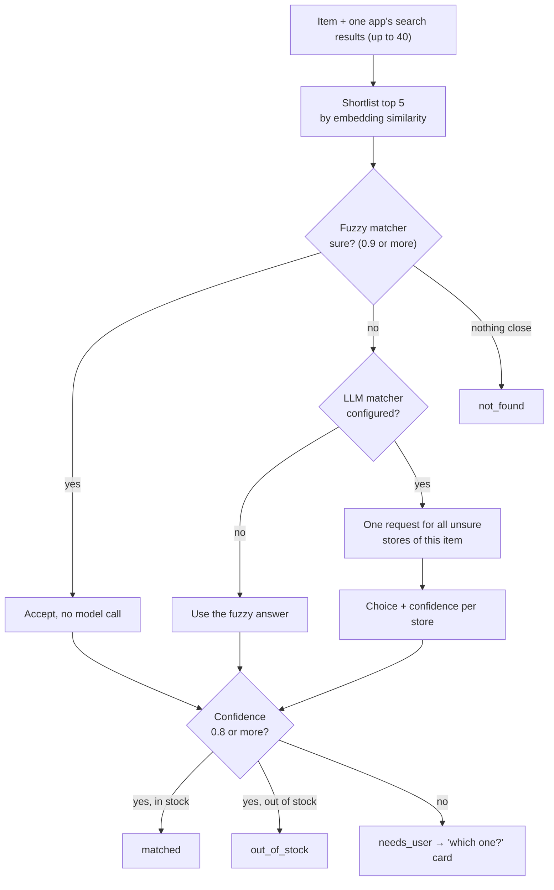
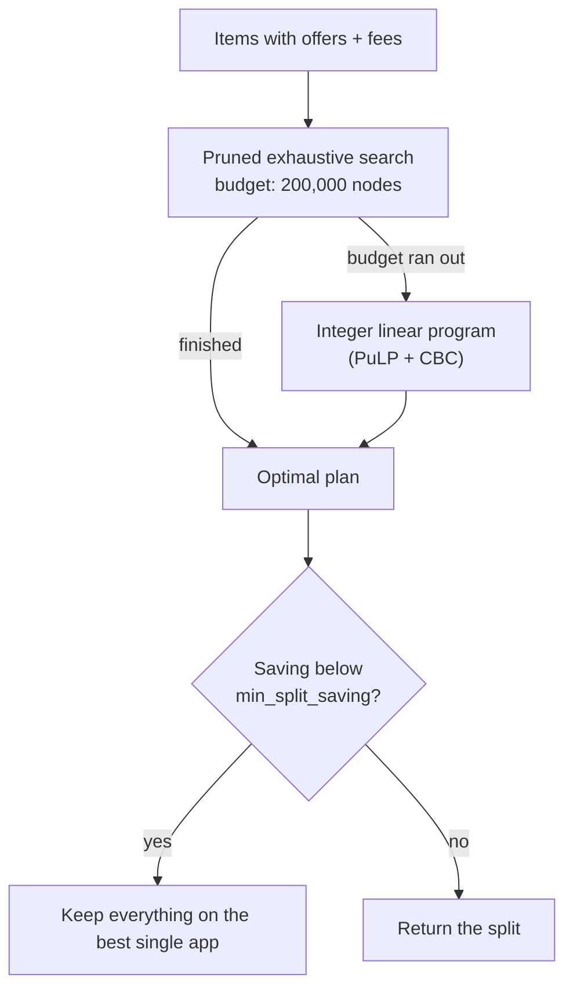

# Matching and the optimiser

The two pieces of real logic in CartPilot. Matching decides *which product* an item
means on each app. The optimiser decides *which app* each item is bought from.

## Matching



### Step 1: shortlist

A store can return 20 or more results. The top 5 by embedding similarity to the
item go forward. The default embedder is local (hashed words and character
trigrams, 512 dimensions): no download, no network, same answer every time. Set
`EMBEDDINGS_API_KEY` to use a hosted model instead.

### Step 2: choose

Two choosers share one interface (`Chooser` in `matching.py`).

**Fuzzy chooser** (always available). Scores each option from 0 to 1:

| Signal | Effect |
|---|---|
| Share of the item's words found in the product name | 70% of the base score |
| `rapidfuzz` token-set similarity | 30% of the base score |
| Extra words in the product name | Small penalty, up to 0.10 |
| Brand asked for but not present | Score halved |
| Pack size differs from the one asked for | Scaled down by how far off it is |
| Store's own ranking | Small bonus for the top results |

Confidence is the top score, reduced when the runner-up is close. So "eggs" with
6, 12 and 30 packs all scoring alike gets a low confidence and becomes a question,
while "aashirvaad atta 5kg" with one clear winner is matched outright. A top score
under 0.5 means "none of these".

**LLM chooser** (Groq, or Jev). The prompt lists the options numbered from 1, with
**0 always meaning "none of these"**, and asks for a choice and a confidence as
JSON. The same class also answers the substitute question.

### Step 3: the confidence gate

Below `CARTPILOT_CONFIDENCE_THRESHOLD` (default 0.8) the item is marked
`needs_user`, and the UI shows a "which one?" card.

### Variants: one question, not three

If an item is unsure on three apps, asking three questions would be tiresome. So
listings of the same real-world product are grouped across apps into *variants*
(same pack size, same brand, and mostly the same words in the name). The card shows
one row per variant with each app's price, and one tap answers for every app.

### Substitutes

Only when the matched product is out of stock on **every** app. Candidates must
contain the item's words, be within 25% of the pack size, and be the same kind of
product. With an LLM configured, the survivors are checked in one more request.
A substitute is offered, never applied on its own, and is labelled if it is a
different brand.

### Keeping model calls low

| Technique | Effect |
|---|---|
| Fuzzy fast path at 0.9 | Clear matches cost no call |
| One request per item, covering all unsure stores | Up to 3 times fewer calls |
| One request for all of an item's substitutes | Instead of one per candidate |
| Retry on 429 and 5xx, waiting at most 4 s | Rate limits do not drop straight to the fallback |
| In-memory cache of identical questions (512 entries) | Re-runs are free |
| Any failure → fuzzy answer for that store | A bad key or outage never breaks a run |

Measured with Groq `openai/gpt-oss-120b` on 7 Oct 2026: a 7-item list went from 21
calls to 4; a clearly written 20-item list needed none.

## The optimiser

Deterministic. No LLM is involved, ever.

### Cost model

For each app that receives at least one item:

```
cart total = subtotal
           + handling fee
           + delivery fee      unless subtotal >= free-delivery threshold
           + small-cart fee    if subtotal < small-cart threshold
```

The plan total is the sum over the apps used. All arithmetic is in integer paise.

Why this is not just "cheapest price per item": sending one cheap item to a second
app can cost a whole extra delivery fee, and moving an item to a slightly dearer
app can lift that cart over its free-delivery line. The solver weighs all of that.

### How it is solved



**Pruned exhaustive search.** A depth-first search over "which app for each item",
costliest items first. A branch is abandoned as soon as *goods so far + cheapest
possible remainder + handling fees already owed* exceeds the best plan found.
Fees are never negative, so that bound is safe. On normal baskets this finishes in
milliseconds even for 40 items.

**ILP fallback.** When prices are nearly identical across apps, pruning cannot cut
much and the search would crawl. After 200,000 nodes the problem is handed to an
ILP:

- `x[i,a]` = item *i* is bought on app *a*
- `used[a]`, `pays_delivery[a]`, `pays_small[a]` = yes/no per app
- each item is bought exactly once; `x[i,a] <= used[a]`
- `subtotal[a] >= threshold[a] * (used[a] - pays_delivery[a])`: a used app either pays delivery or reaches the threshold
- the same pattern for the small-cart fee; `sum(used) <= max_apps`
- minimise goods + handling + delivery + small-cart fees

Both methods are exact. The tests check each against a separate plain brute force
on 100 random problems, and against each other on larger ones.

### Baselines and savings

For each app, the cost of buying everything it carries there. The cheapest app
that carries **every** item is the comparison point, so:

```
savings = cheapest complete single-app total - plan total
```

If no single app has everything, savings are reported as unknown rather than
compared against an incomplete basket.

### Knobs

| Option | Effect |
|---|---|
| `max_apps` | "Use at most N apps" |
| `min_split_saving` | "Only split if it saves at least ₹X"; otherwise stay on one app |
| Fee overrides | Edit any fee in the UI and the plan is solved again |
